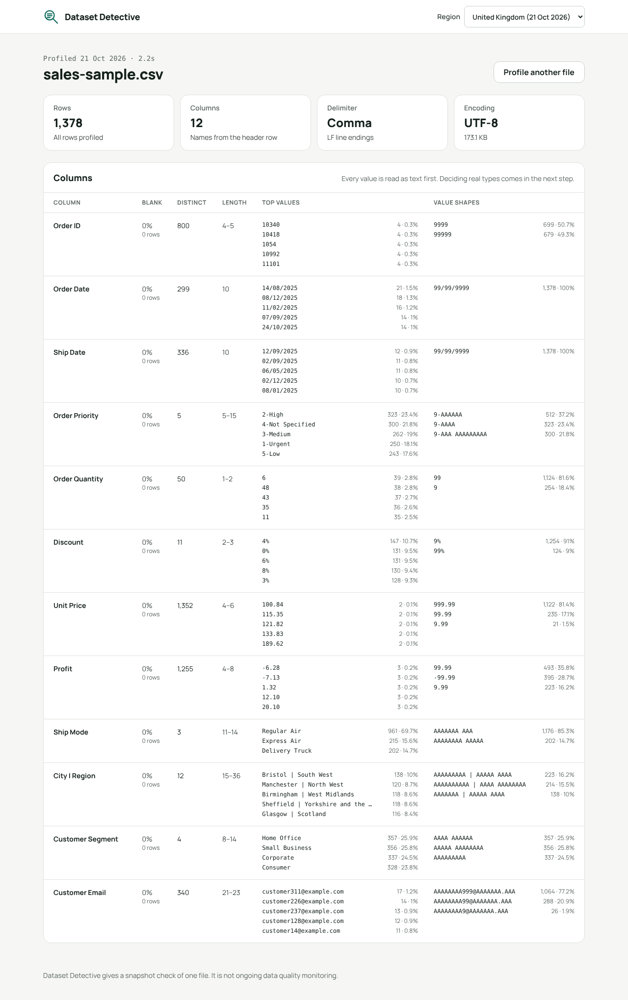
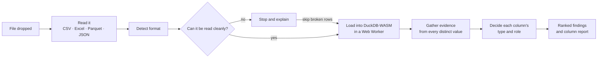

# Dataset Detective

**Find what's wrong with a file before anyone builds on it.**

Dataset Detective profiles a CSV, Excel, Parquet or JSON file entirely in your browser. It works out how the file is written, whether it reads cleanly, and what each column really contains — and nothing is uploaded anywhere.

[](https://github.com/NanaYawJr/dataset-detective/actions/workflows/ci.yml)
[](https://codespaces.new/NanaYawJr/dataset-detective)

**Try it:** [detective.michaelopokukwarteng.com](https://detective.michaelopokukwarteng.com)



## Why

Most data problems are cheapest to catch the moment a file arrives — before it's loaded into a model, a report or a warehouse. Enterprise data quality platforms are built for data that already lives inside a governed platform; they take weeks to set up and are rarely approved for a file someone emailed this morning. So people open it in Excel and eyeball it.

Dataset Detective is a fast triage step for that moment: a quick, honest check of one file, with no installation and no data leaving the device. It is a snapshot check, not ongoing data quality monitoring.

## What it does today

**Loading the file (0.1, more formats in 0.4)**

- **Detects how the file is written:** encoding (UTF-8, UTF-8 with BOM, UTF-16, Windows-1252), delimiter (comma, semicolon, tab, pipe), header row and line endings.
- **Checks it can be read cleanly** and, if not, stops and explains why in plain English — which lines have the wrong number of columns, or where a quote is never closed. You can choose to skip broken rows; skipped rows are counted, never hidden.
- **Full file or a repeatable sample** of 100,000 rows for large files.
- **Excel workbooks (.xlsx):** finds the table under any title rows, lets you pick the sheet, and turns Excel's stored day counts into real dates. It reports hidden sheets, merged cells, error values and formulas that were never calculated.
- **Parquet:** reports the types the file declares, then checks the values anyway — a column declared as text that holds dates or amounts is flagged.
- **JSON and JSON Lines:** finds the list of records (even under a key such as `results`), flattens nested objects into `address.city`-style columns, and keeps lists as text.

**Deciding each column (0.2)**

- **Type and role from evidence:** whole number, decimal, percent, currency, date or text; identifier, measure, category, date, free text or personal data. Statistics follow the decision: range, mean and median for measures, earliest and latest for dates, uniqueness for identifiers — never an average of an ID.
- **Dates decided by proof, not by locale:** a value like `31/12/2023` can only be day-first, so it proves the column's order. Columns that can't prove their order borrow it from one that can in the same file. Only when nothing proves it does the region setting offer a suggestion — clearly marked as one — and for Canada, where both orders are common, it asks instead of guessing.
- **Ranked findings in plain English:** numbers stored as text (`"5%"`), identifiers that repeat, two fields packed into one column (`City | Region`), placeholders that hide missing data (`"4-Not Specified"`, `N/A`, `1900-01-01`), ranks written into text (`1-Urgent`), impossible dates, and personal data — email addresses, UK postcodes, phone numbers, National Insurance numbers and NHS numbers, which are checked with their modulus 11 check digit.
- **Region setting** (United Kingdom, Canada, United States) for how dates and numbers are shown. Dates are never displayed as ambiguous slash dates. Changing the region re-decides the loaded file instantly.

**Checking the table as a whole (0.3)**

- **Duplicates and grain:** exact copies of rows are counted, and the file is described in one sentence — "Each row is one Order ID", or one combination of two columns — or flagged when nothing identifies a row.
- **Dependencies:** rules such as "each City has exactly one Region" are found, including inside a packed column. When a rule nearly holds, the values that break it are named, because those are usually typos.
- **Order of events:** when one date column is almost always on or after another, the rows where it isn't are counted (a Ship Date before its Order Date).
- **Date coverage:** a rows-per-month chart for each date column; months with no rows in an otherwise steady run, and dates in the future, are flagged.
- **Corrections:** if a decision is wrong, change a column's role or date order. Everything updates, and the correction is labelled as yours, with the original evidence still visible.

**Fixing what was found (0.5)**

- **A cleaning script in three languages:** Power Query (M), T-SQL and pandas, written from the profile. It turns placeholders into real blanks, converts `"5%"` and `"£1,200"` to numbers, reads dates in the order the evidence proved, splits packed columns, and adds a sortable number for ranks written into text.
- **It says what it leaves alone, and why:** codes with leading zeros stay as text, and a date column whose order nothing proves is not converted until you choose the order. Change a decision with "Correct this" and the script changes with it.
- **Safe by construction:** a value that can't be converted becomes blank, never an error and never a wrong value.

**Comparing with an earlier version (0.5)**

- **What changed since last time:** profile this month's extract, then choose last month's. The comparison lists columns added, removed, renamed or reordered; types and date orders that changed; new missing values; category values that appeared or disappeared; shifted averages and suspicious new maximums; date ranges that moved; and problems that are new or have gone.
- **Row by row, when the file has a key:** rows are matched on a column that is unique in both files, giving counts of rows added, removed and edited, which columns were edited, and example keys.
- Try it with [`samples/sales-sample-previous.csv`](samples/sales-sample-previous.csv), the sample as it looked one delivery earlier.

Every value is read as text first, whatever the file format. Deciding what a column really is — a number, a date, an ID — is the job of the rule engine, not the file reader, so a value like `03/04/2026` is never silently turned into the wrong date, and every check works the same on every format.

## Roadmap

| Milestone  | Scope                                                                                                                                                       |
| ---------- | ----------------------------------------------------------------------------------------------------------------------------------------------------------- |
| **0.1** ✅ | Load the file: format detection, clean-read check, raw column statistics                                                                                    |
| **0.2** ✅ | Decide each column: numbers stored as text, identifiers, dates with day/month evidence, packed fields (`City \| Region`), placeholder blanks, personal data |
| **0.3** ✅ | Whole-table checks and ranked alerts: keys and grain, dependencies, order of events, duplicates, date coverage; corrections; first public deployment        |
| **0.4** ✅ | More file formats: Excel workbooks, Parquet, JSON and JSON Lines, all read in the browser                                                                   |
| **0.5** ✅ | Cleaning scripts in Power Query M, T-SQL and pandas; comparing a file with an earlier version of it                                                         |
| 0.6        | Optional, opt-in plain-English explanation of a report, sending a masked summary only — never rows                                                          |
| Later      | Suggested validation rules for the next delivery; a report to share                                                                                         |

## Privacy

- Files are read with the browser's File API and analysed by [DuckDB-WASM](https://duckdb.org/docs/stable/clients/wasm/overview), a database engine compiled to WebAssembly that runs inside the page.
- The production build sets a strict [Content Security Policy](docs/decisions/0004-strict-content-security-policy.md): the page may only load and fetch from its own address, so it cannot send your data to anyone else. The engine is bundled with the site rather than fetched from a CDN, and extension downloads are switched off. Excel, Parquet and JSON files are read by code that ships with the page, for the same reason.
- The only thing stored in your browser is your region choice.
- Usage is counted anonymously: the page tells its own server that it was opened and that a file of some format was profiled, and nothing about the file. Visitors are told apart in memory only, with a key that is replaced daily, so nobody is tracked. The exact signals are listed in [PRIVACY.md](PRIVACY.md).

See [PRIVACY.md](PRIVACY.md) for details.

## How it works



The full design, including the stages still to come, is in [docs/architecture.md](docs/architecture.md). Key choices are recorded in [docs/decisions](docs/decisions).

## Tech stack

- **React 19 + TypeScript**, built with **Vite**
- **DuckDB-WASM** for in-browser SQL, running in a Web Worker
- **fflate** to unzip Excel workbooks (read by a small purpose-built reader) and **hyparquet** to read Parquet, both in a Web Worker
- **Tailwind CSS** for styling
- **Vitest** for unit tests, **Playwright** for browser tests against the production build
- **oxlint** and **Prettier** for linting and formatting
- **FastAPI** and **SQLite** for the small server that counts usage, tested with **pytest**
- **Caddy** as the web server, in a container on **Railway**
- **GitHub Actions** for CI and publishing

## Getting started

### In GitHub Codespaces

Click **Open in GitHub Codespaces** above. Dependencies install automatically; then run:

```bash
npm run dev
```

The app opens in a preview tab on port 5173.

### On your own machine

Requires Node.js 22 or later.

```bash
npm ci
npm run dev
```

Try it with the included sample files in [`samples/`](samples): the same sales extract as CSV, as an Excel workbook (with a title above the header and a second sheet) and as Parquet.

## Deployment

The site is built into a small container and served by Caddy with strict security headers. See [docs/deployment.md](docs/deployment.md).

## Scripts

| Command              | What it does                                                       |
| -------------------- | ------------------------------------------------------------------ |
| `npm run dev`        | Start the development server                                       |
| `npm run build`      | Type-check and build for production into `dist/`                   |
| `npm run preview`    | Serve the production build locally                                 |
| `npm run check`      | Type-check, lint, check formatting and run unit tests              |
| `npm test`           | Run unit tests once                                                |
| `npm run test:watch` | Run unit tests on every change                                     |
| `npm run test:e2e`   | Build, then run browser tests with the security policy switched on |
| `npm run format`     | Format all files                                                   |
| `npm run sample`     | Regenerate the synthetic sample file                               |

The Excel and Parquet samples and test files are written by `python scripts/make-fixtures.py` and committed, so Python is only needed to change them.

Browser tests need Chromium the first time: `npx playwright install --with-deps chromium`.

## Testing

The tests are built around a **golden sample**: [`samples/sales-sample.csv`](samples/sales-sample.csv), a synthetic sales extract generated by [`scripts/make-sample.mjs`](scripts/make-sample.mjs) with deliberate, known problems — repeated order IDs, discounts stored as `"5%"`, a packed `City | Region` column, a `4-Not Specified` placeholder, day-first dates with a missing month, and rows that ship before they were ordered. Because the problems are known in advance, every check can be tested against an exact expected answer.

- **Unit tests** cover format detection, the column rules, NHS check digits, placeholders, region formatting and plain-English explanations.
- **Format tests** read Excel and Parquet files written by four different real programs (openpyxl, XlsxWriter, pyarrow and DuckDB), and prove that the Excel and Parquet samples give the same column decisions as the CSV sample.
- **Integration tests** run the real evidence SQL on the same DuckDB engine the browser uses, in Node, against the golden sample and a personal-data fixture, with expected answers computed independently.
- **Generated code tests:** the pandas script written for each sample (CSV, Excel, Parquet) is run for real in Python, and the cleaned result is checked: 1,378 rows, `5%` as 0.05, real dates, 300 placeholders blank. The T-SQL and Power Query scripts are checked for structure; they are not executed by the tests.
- **Server tests** (pytest) cover the usage counts, the password and lockout on the private usage page, and prove that no address or browser detail is written to disk.
- **Browser tests** run the production build in Chromium with the security policy active, and fail on any console error — so a policy violation is caught, not just a wrong number.

## Project structure

```
src/
  lib/format/     Encoding, delimiter and header detection; plain-English explanations
  lib/source/     Readers for Excel, Parquet and JSON, and the worker they run in
  lib/profile/    DuckDB setup, evidence SQL and the profiling pipeline
  lib/rules/      Column decisions, findings, corrections, placeholder and NHS number checks
  lib/table/      Whole-table checks: planning, SQL and interpretation
  lib/fix/        The fix plan and its three writers: Power Query, T-SQL, pandas
  lib/compare/    Comparing a file with an earlier version: rules, SQL and row matching
  lib/region.ts   Region setting: date and number display
  lib/usage.ts    The anonymous usage signals
  hooks/          The React hook that runs the pipeline
  components/     Upload, progress, stop, findings and results screens
samples/          The golden sample as CSV, Excel and Parquet, and an earlier delivery of it
scripts/          Sample and fixture generators
e2e/              Browser tests
api/              The server beside the site: anonymous usage counts (FastAPI)
docs/             Architecture and decision records
```

## Feedback

Feedback is very welcome — please [open an issue](https://github.com/NanaYawJr/dataset-detective/issues/new/choose). **Please don't attach real or sensitive data**; a small made-up file that shows the problem is ideal.

## Licence

[MIT](LICENSE) © 2026 Michael Opoku Kwarteng — [michaelopokukwarteng.com](https://michaelopokukwarteng.com)
