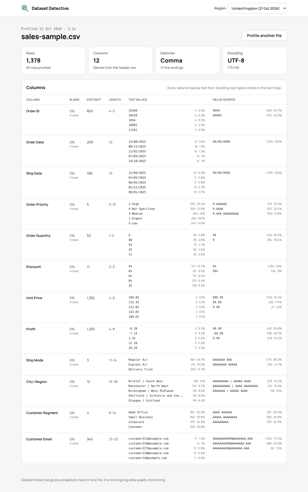
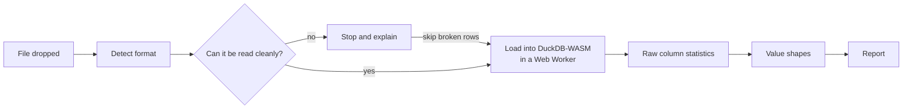

# Dataset Detective

**Find what's wrong with a file before anyone builds on it.**

Dataset Detective profiles a CSV entirely in your browser. It works out how the file is written, whether it reads cleanly, and what each column really contains — and nothing is uploaded anywhere.

[](https://github.com/NanaYawJr/dataset-detective/actions/workflows/ci.yml)
[](https://codespaces.new/NanaYawJr/dataset-detective)

**Live demo:** _coming soon_



## Why

Most data problems are cheapest to catch the moment a file arrives — before it's loaded into a model, a report or a warehouse. Enterprise data quality platforms are built for data that already lives inside a governed platform; they take weeks to set up and are rarely approved for a file someone emailed this morning. So people open it in Excel and eyeball it.

Dataset Detective is a fast triage step for that moment: a quick, honest check of one file, with no installation and no data leaving the device. It is a snapshot check, not ongoing data quality monitoring.

## What it does today

Version 0.1 covers the first stage of the pipeline — loading a file and describing it:

- **Detects how the file is written:** encoding (UTF-8, UTF-8 with BOM, UTF-16, Windows-1252), delimiter (comma, semicolon, tab, pipe), header row and line endings.
- **Checks it can be read cleanly** and, if not, stops and explains why in plain English — which lines have the wrong number of columns, or where a quote is never closed. You can choose to skip broken rows; skipped rows are counted, never hidden.
- **Profiles every column:** blanks, distinct values, value lengths, top values, and _value shapes_ (`LS1 4AB` → `AA9 9AA`, `03/04/2026` → `99/99/9999`).
- **Full file or a repeatable sample** of 100,000 rows for large files.
- **Region setting** (United Kingdom, Canada, United States) for how dates and numbers are shown. Dates are never displayed as ambiguous slash dates.

Every value is read as text first. Deciding what a column really is — a number, a date, an ID — is the job of the rule engine, not the CSV reader, so a value like `03/04/2026` is never silently turned into the wrong date.

## Roadmap

| Milestone  | Scope                                                                                                                                                       |
| ---------- | ----------------------------------------------------------------------------------------------------------------------------------------------------------- |
| **0.1** ✅ | Load the file: format detection, clean-read check, raw column statistics                                                                                    |
| 0.2        | Decide each column: numbers stored as text, identifiers, dates with day/month evidence, packed fields (`City \| Region`), placeholder blanks, personal data |
| 0.3        | Whole-table checks and ranked alerts: keys and grain, dependencies, order of events, duplicates, date coverage; first public deployment                     |
| 0.4        | Fix and export: Power Query M, T-SQL and pandas code, suggested validation rules, PDF report, saved profiles                                                |
| 0.5        | Excel, Parquet and JSON files; compare two files                                                                                                            |
| 0.6        | Optional, opt-in plain-English explanation of a report, sending a masked summary only — never rows                                                          |

## Privacy

- Files are read with the browser's File API and analysed by [DuckDB-WASM](https://duckdb.org/docs/stable/clients/wasm/overview), a database engine compiled to WebAssembly that runs inside the page.
- The production build sets a strict [Content Security Policy](docs/decisions/0004-strict-content-security-policy.md): the page may only load and fetch its own files, so it cannot send your data anywhere. The engine is bundled with the site rather than fetched from a CDN, and extension downloads are switched off.
- The only thing stored is your region choice, in your own browser.

See [PRIVACY.md](PRIVACY.md) for details.

## How it works



The full design, including the stages still to come, is in [docs/architecture.md](docs/architecture.md). Key choices are recorded in [docs/decisions](docs/decisions).

## Tech stack

- **React 19 + TypeScript**, built with **Vite**
- **DuckDB-WASM** for in-browser SQL, running in a Web Worker
- **Tailwind CSS** for styling
- **Vitest** for unit tests, **Playwright** for browser tests against the production build
- **oxlint** and **Prettier** for linting and formatting
- **GitHub Actions** for CI

## Getting started

### In GitHub Codespaces

Click **Open in GitHub Codespaces** above. Dependencies install automatically; then run:

```bash
npm run dev
```

The app opens in a preview tab on port 5173.

### On your own machine

Requires Node.js 22 or later.

```bash
npm ci
npm run dev
```

Try it with the included sample file: [`samples/sales-sample.csv`](samples/sales-sample.csv).

## Scripts

| Command              | What it does                                                       |
| -------------------- | ------------------------------------------------------------------ |
| `npm run dev`        | Start the development server                                       |
| `npm run build`      | Type-check and build for production into `dist/`                   |
| `npm run preview`    | Serve the production build locally                                 |
| `npm run check`      | Type-check, lint, check formatting and run unit tests              |
| `npm test`           | Run unit tests once                                                |
| `npm run test:watch` | Run unit tests on every change                                     |
| `npm run test:e2e`   | Build, then run browser tests with the security policy switched on |
| `npm run format`     | Format all files                                                   |
| `npm run sample`     | Regenerate the synthetic sample file                               |

Browser tests need Chromium the first time: `npx playwright install --with-deps chromium`.

## Testing

The tests are built around a **golden sample**: [`samples/sales-sample.csv`](samples/sales-sample.csv), a synthetic sales extract generated by [`scripts/make-sample.mjs`](scripts/make-sample.mjs) with deliberate, known problems — repeated order IDs, discounts stored as `"5%"`, a packed `City | Region` column, a `4-Not Specified` placeholder, day-first dates with a missing month, and rows that ship before they were ordered. Because the problems are known in advance, every check can be tested against an exact expected answer.

- **Unit tests** cover format detection, quoting, SQL generation, region formatting and plain-English explanations.
- **Browser tests** run the production build in Chromium with the security policy active, and fail on any console error — so a policy violation is caught, not just a wrong number.

## Project structure

```
src/
  lib/format/     Encoding, delimiter and header detection; plain-English explanations
  lib/profile/    DuckDB setup, SQL builders and the profiling pipeline
  lib/region.ts   Region setting: date and number display
  hooks/          The React hook that runs the pipeline
  components/     Upload, progress, stop and results screens
samples/          The golden sample file
scripts/          Sample generator
e2e/              Browser tests
docs/             Architecture and decision records
```

## Feedback

Feedback is very welcome — please [open an issue](https://github.com/NanaYawJr/dataset-detective/issues/new/choose). **Please don't attach real or sensitive data**; a small made-up file that shows the problem is ideal.

## Licence

[MIT](LICENSE) © 2026 Michael Opoku Kwarteng — [michaelopokukwarteng.com](https://michaelopokukwarteng.com)
