# Architecture

Dataset Detective is a static web app. All profiling happens in the browser; there is no server in the profiling path.

## The pipeline

The system is organised as five stages. Stages 1 to 3 are built; the others are planned and shown here so the design is visible as a whole.

```mermaid
flowchart TB
  subgraph S1[1 · Load the file]
    A[File dropped] --> A2[Read it<br/>CSV · Excel · Parquet · JSON]
    A2 --> B[Detect format<br/>encoding · delimiter · header]
    B --> C{Can it be read cleanly?}
    C -- no --> X[Stop and explain]
    C -- yes --> D[Choose scope<br/>full file or sample]
    X -- skip broken rows --> D
    D --> E[Load into DuckDB-WASM<br/>Web Worker]
    E --> F[Raw stats and value shapes]
  end

  subgraph S2[2 · Decide each column]
    G{Number stored as text?} --> H{Looks like an ID?}
    H --> I{Looks like a date?}
    I --> J{Two fields in one column?}
    J --> K{Placeholder values?}
    K --> L{Personal data?}
  end

  subgraph S3[3 · Check the whole table]
    M[Keys and grain] --> N[Dependencies]
    N --> O[Order of events]
    O --> P[Duplicates and coverage]
    P --> Q[Score and rank alerts]
    Q --> R{User overrides a call?}
    R -- yes: re-score --> Q
  end

  subgraph S4[4 · Outputs]
    T[Report · fix code · validation rules · profile JSON]
  end

  subgraph S5[5 · Optional explainer]
    U[Mask personal values] --> V[Build summary payload]
    V --> W{User approves send?}
    W -- yes --> Y[Proxy → language model]
    Y --> Z[Check figures against profile]
  end

  F --> G
  L --> M
  R -- no --> T
  T -. opt-in .-> U
  Z --> T
  W -- no --> T
```



### Stage 1 · Load the file (built)

| Step               | Where                                    | Notes                                                                                                                                                                                                                               |
| ------------------ | ---------------------------------------- | ----------------------------------------------------------------------------------------------------------------------------------------------------------------------------------------------------------------------------------- |
| What kind of file? | `lib/source/kind.ts`                     | Decided from the first bytes, then the name: a workbook renamed to `.csv` is still a workbook.                                                                                                                                      |
| Prepare            | `lib/source/prepare.ts`, in a Web Worker | Delimited text is passed through. Excel, Parquet and JSON are read and written out as CSV text in memory, so every later step is the same for all formats. See [decision 0008](decisions/0008-read-every-format-in-the-browser.md). |
| Detect format      | `lib/format/detectFormat.ts`             | For delimited text, from the first 1 MB: encoding from byte-order marks and UTF-8 validity; delimiter by which candidate splits rows most consistently; header by comparing the first row with the rows below.                      |
| Clean-read check   | `detectFormat` → `problems`              | Wrong field counts, unclosed quotes, empty or binary files block loading. Blank or duplicate column names are noted but don't block.                                                                                                |
| Load               | `profiler.ts` → `profileFile`            | Registers the file with DuckDB (UTF-8 is streamed; other encodings are converted in memory first) and creates a table with every column as text.                                                                                    |
| Raw statistics     | `lib/profile/factsSql.ts`                | Counts, top values and value shapes for every column, read from the value-counts table built in stage 2.                                                                                                                            |

The readers in `lib/source`:

| Format  | Where                          | Notes                                                                                                                                                                                                                             |
| ------- | ------------------------------ | --------------------------------------------------------------------------------------------------------------------------------------------------------------------------------------------------------------------------------- |
| Excel   | `xlsx.ts`, `xml.ts`, `grid.ts` | A workbook is a zip of XML. It is unzipped with fflate and scanned once, without building a tree. `grid.ts` finds the header row under titles and notes. Cells with a date format are converted from Excel's day count to a date. |
| Parquet | `parquet.ts`, `declared.ts`    | Read with hyparquet, one row group at a time. The declared types are kept so they can be compared with what the values turn out to be.                                                                                            |
| JSON    | `json.ts`                      | Finds the list of records, flattens nested objects, keeps lists as JSON text.                                                                                                                                                     |

The React side is a small state machine in `hooks/useProfiler.ts`: `idle → running → done`, with `blocked` (the format check stopped it) and `failed` (DuckDB stopped part-way) as the two ways out.

### Stage 2 · Decide each column (built)

| Step             | Where                            | Notes                                                                                                                                                                                                                                                                                                                                         |
| ---------------- | -------------------------------- | --------------------------------------------------------------------------------------------------------------------------------------------------------------------------------------------------------------------------------------------------------------------------------------------------------------------------------------------- |
| Value counts     | `factsSql.ts` → `valueCountsSql` | Unpivots the table once into a temporary table of each distinct non-blank value per column and how many rows hold it.                                                                                                                                                                                                                         |
| Evidence         | `factsSql.ts` → `columnFactsSql` | One query computes about 30 counts per column — number shapes, date parts, separators, placeholders, personal-data patterns — once per distinct value, weighted by row count. Cheap pre-checks (length, first character, `contains`) run before any regular expression. See [decision 0005](decisions/0005-evidence-from-distinct-values.md). |
| Decide           | `lib/rules/decide.ts`            | Pure TypeScript: turns the evidence into a type, a role and findings for each column, then lets a column that proves its date order settle it for unproven date columns in the same file.                                                                                                                                                     |
| Typed statistics | `factsSql.ts` → `typedStatsSql`  | One query for the statistics that depend on the decision: range, mean, median and standard deviation for measures; earliest and latest for dates.                                                                                                                                                                                             |

The rules are deterministic and every finding carries its evidence. Changing the region re-runs only the decision and typed-statistics steps against the table already loaded.

### Stage 3 · Check the whole table (built)

| Step      | Where                                   | Notes                                                                                                                                                                                                                                                                    |
| --------- | --------------------------------------- | ------------------------------------------------------------------------------------------------------------------------------------------------------------------------------------------------------------------------------------------------------------------------ |
| Plan      | `lib/table/plan.ts`                     | Chooses which checks are worth running from the column decisions: key pairs only when no single column is a key, dependency pairs only between low-cardinality columns and the parts of packed columns, date pairs between decided date columns.                         |
| Query     | `lib/table/tableSql.ts`                 | Four queries: keys and duplicates; dependencies (each pair grouped once, both directions read from the result); order of dates; rows per month. Dates are parsed once per distinct value or pair of values. See [decision 0006](decisions/0006-planned-table-checks.md). |
| Run       | `lib/table/run.ts`                      | Runs the plan with any engine that answers SQL with rows — DuckDB-WASM in the browser, the same engine in Node in tests.                                                                                                                                                 |
| Interpret | `lib/table/interpret.ts`                | Pure TypeScript: turns the counts into findings and the grain sentence, with thresholds for when a rule "nearly holds".                                                                                                                                                  |
| Correct   | `lib/rules/decide.ts` → `applyOverride` | A user's correction is applied after the evidence-based decision, then stages 2 and 3 re-run on the table already loaded.                                                                                                                                                |

### Stage 4 · Outputs (in progress)

| Step  | Where                                           | Notes                                                                                                                                                                                    |
| ----- | ----------------------------------------------- | ---------------------------------------------------------------------------------------------------------------------------------------------------------------------------------------- |
| Plan  | `lib/fix/plan.ts`                               | Turns the column decisions into steps (drop, blank out placeholders, to number, to date, split, rank) in a form that belongs to no language. It also records what is left alone and why. |
| Write | `lib/fix/powerQuery.ts`, `tsql.ts`, `pandas.ts` | Each writer turns the same plan into a complete script, with the reading step adapted to the kind of file. See [decision 0010](decisions/0010-one-fix-plan-three-languages.md).          |
| Show  | `components/FixPanel.tsx`                       | Summary, language tabs, copy and download. Re-derived from the profile, so a correction changes the script.                                                                              |

### Comparing with an earlier version

| Step    | Where                                 | Notes                                                                                                                                                                                                                      |
| ------- | ------------------------------------- | -------------------------------------------------------------------------------------------------------------------------------------------------------------------------------------------------------------------------- |
| Profile | `profiler.ts` → `compareWithEarlier`  | The earlier file goes through the same stages into a second table, `earlier`, beside the current file's `data`.                                                                                                            |
| Compare | `lib/compare/run.ts`, `compareSql.ts` | Queries over both tables: category values in only one file, and, when a column is unique in both, a full outer join on it for rows added, removed and edited. See [decision 0011](decisions/0011-compare-two-profiles.md). |
| Explain | `lib/compare/compare.ts`              | Pure TypeScript: compares the two profiles column by column and turns the differences into plain-English changes, ranked by severity.                                                                                      |

### Why everything is read as text

CSV readers guess types. A guess that `03/04/2026` is 4 March rather than 3 April is silently wrong for half the world. Reading text keeps every value exactly as written, so later stages can decide types from evidence — and say what that evidence was.

## Where it runs

```
Browser tab
├── React UI (main thread)
│     └── format detection on a 1 MB sample
└── DuckDB-WASM (Web Worker)
      └── file streamed from disk via the File API
```

No data leaves the tab. The production build's Content Security Policy only allows the page to load and connect to its own origin. See [decision 0004](decisions/0004-strict-content-security-policy.md).

The site is served as static files from a small container, beside a small server that counts usage anonymously ([decision 0009](decisions/0009-anonymous-usage-counts.md)); the server sends the same policy as a header. See [deployment](deployment.md) and [decision 0007](decisions/0007-static-site-in-a-container.md).

## Decision records

Significant choices are recorded in [docs/decisions](decisions), one file each, with the context and trade-offs at the time.
