# Architecture

Dataset Detective is a static web app. All profiling happens in the browser; there is no server in the profiling path.

## The pipeline

The system is organised as five stages. Stages 1 and 2 are built; the others are planned and shown here so the design is visible as a whole.

```mermaid
flowchart TB
  subgraph S1[1 · Load the file]
    A[File dropped] --> B[Detect format<br/>encoding · delimiter · header]
    B --> C{Can it be read cleanly?}
    C -- no --> X[Stop and explain]
    C -- yes --> D[Choose scope<br/>full file or sample]
    X -- skip broken rows --> D
    D --> E[Load into DuckDB-WASM<br/>Web Worker]
    E --> F[Raw stats and value shapes]
  end

  subgraph S2[2 · Decide each column]
    G{Number stored as text?} --> H{Looks like an ID?}
    H --> I{Looks like a date?}
    I --> J{Two fields in one column?}
    J --> K{Placeholder values?}
    K --> L{Personal data?}
  end

  subgraph S3[3 · Check the whole table]
    M[Keys and grain] --> N[Dependencies]
    N --> O[Order of events]
    O --> P[Duplicates and coverage]
    P --> Q[Score and rank alerts]
    Q --> R{User overrides a call?}
    R -- yes: re-score --> Q
  end

  subgraph S4[4 · Outputs]
    T[Report · fix code · validation rules · profile JSON]
  end

  subgraph S5[5 · Optional explainer]
    U[Mask personal values] --> V[Build summary payload]
    V --> W{User approves send?}
    W -- yes --> Y[Proxy → language model]
    Y --> Z[Check figures against profile]
  end

  F --> G
  L --> M
  R -- no --> T
  T -. opt-in .-> U
  Z --> T
  W -- no --> T
```



### Stage 1 · Load the file (built)

| Step                | Where                                     | Notes                                                                                                                                                                 |
| ------------------- | ----------------------------------------- | --------------------------------------------------------------------------------------------------------------------------------------------------------------------- |
| Read the first 1 MB | `lib/profile/profiler.ts` → `inspectFile` | Only a sample is read for detection, so huge files start instantly.                                                                                                   |
| Detect format       | `lib/format/detectFormat.ts`              | Encoding from byte-order marks and UTF-8 validity; delimiter by which candidate splits rows most consistently; header by comparing the first row with the rows below. |
| Clean-read check    | `detectFormat` → `problems`               | Wrong field counts, unclosed quotes, empty or binary files block loading. Blank or duplicate column names are noted but don't block.                                  |
| Load                | `profiler.ts` → `profileFile`             | Registers the file with DuckDB (UTF-8 is streamed; other encodings are converted in memory first) and creates a table with every column as text.                      |
| Raw statistics      | `lib/profile/factsSql.ts`                 | Counts, top values and value shapes for every column, read from the value-counts table built in stage 2.                                                              |

The React side is a small state machine in `hooks/useProfiler.ts`: `idle → running → done`, with `blocked` (the format check stopped it) and `failed` (DuckDB stopped part-way) as the two ways out.

### Stage 2 · Decide each column (built)

| Step             | Where                            | Notes                                                                                                                                                                                                                                                                                                                                         |
| ---------------- | -------------------------------- | --------------------------------------------------------------------------------------------------------------------------------------------------------------------------------------------------------------------------------------------------------------------------------------------------------------------------------------------- |
| Value counts     | `factsSql.ts` → `valueCountsSql` | Unpivots the table once into a temporary table of each distinct non-blank value per column and how many rows hold it.                                                                                                                                                                                                                         |
| Evidence         | `factsSql.ts` → `columnFactsSql` | One query computes about 30 counts per column — number shapes, date parts, separators, placeholders, personal-data patterns — once per distinct value, weighted by row count. Cheap pre-checks (length, first character, `contains`) run before any regular expression. See [decision 0005](decisions/0005-evidence-from-distinct-values.md). |
| Decide           | `lib/rules/decide.ts`            | Pure TypeScript: turns the evidence into a type, a role and findings for each column, then lets a column that proves its date order settle it for unproven date columns in the same file.                                                                                                                                                     |
| Typed statistics | `factsSql.ts` → `typedStatsSql`  | One query for the statistics that depend on the decision: range, mean, median and standard deviation for measures; earliest and latest for dates.                                                                                                                                                                                             |

The rules are deterministic and every finding carries its evidence. Changing the region re-runs only the decision and typed-statistics steps against the table already loaded.

### Why everything is read as text

CSV readers guess types. A guess that `03/04/2026` is 4 March rather than 3 April is silently wrong for half the world. Reading text keeps every value exactly as written, so later stages can decide types from evidence — and say what that evidence was.

## Where it runs

```
Browser tab
├── React UI (main thread)
│     └── format detection on a 1 MB sample
└── DuckDB-WASM (Web Worker)
      └── file streamed from disk via the File API
```

No data leaves the tab. The production build's Content Security Policy only allows the page to load and connect to its own origin. See [decision 0004](decisions/0004-strict-content-security-policy.md).

## Decision records

Significant choices are recorded in [docs/decisions](decisions), one file each, with the context and trade-offs at the time.
